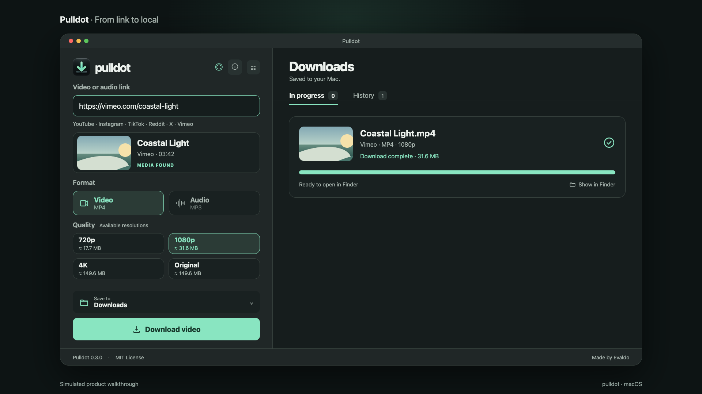

<div align="center">
  
  <h1>Pulldot</h1>
  <p>A quick look at Pulldot for macOS.</p>
  <p>Native macOS · Free and open source · MIT License</p>
  <p><a href="#preview">Watch the demo</a> · <a href="README.pt-BR.md">Português</a></p>
</div>

Pulldot is a free, open-source macOS app for downloading video and audio from links. This repository contains a short simulated walkthrough of its interface, along with the editable Remotion project.

## Preview

[](pulldot-demo-web.mp4)

*The interface, URL, media details, file size, and download progress are simulated for this demo.*

## What the demo shows

- Paste a video link and identify its media automatically.
- Choose video or audio and see available quality options with estimated file sizes.
- Follow download progress, percentage, transfer speed, and estimated time remaining.
- See the completed file ready to open in Finder.

## Video

The H.264 video is 1920×1080 at 30 fps, lasts 12 seconds, and has no audio. It is ready to embed on a website:

```html
<video controls muted playsinline poster="pulldot-poster.png">
  <source src="pulldot-demo-web.mp4" type="video/mp4">
</video>
```

## License

The demo and source are available under the [MIT License](LICENSE).

Made by **Evaldo**.
